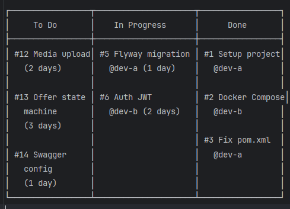

# Git Workflow для команды из двух junior-разработчиков

> Простой, но профессиональный процесс. Без излишеств, но с порядком.

---

## 🎯 Зачем это нужно

Без правил Git превращается в хаос:
- Конфликты в `main` → сломанная сборка
- Непонятно кто что делает → дублирование работы
- Нет истории изменений → невозможно откатиться
- Нет ревью → баги попадают в продакшен

**Цель:** порядок без бюрократии. Процесс должен помогать, а не мешать.

---

##  Модель веток

### Основные ветки
| Ветка | Назначение | Кто пушит | Защита |
|-------|------------|-----------|--------|
| `main` | Стабильная версия, всегда работает | Никто напрямую | ✅ Защищена (только через PR) |
| `develop` | Интеграция фич, может быть нестабильна | Через PR | ⚠️ Опционально |

**Для MVP упрощаем:** используем только `main`. `develop` добавим когда команда вырастет.

### Фиче-ветки
Каждая задача = отдельная ветка от `main`:
* feature/auth-registration # новая фича
* feature/tier-crud # новая фича
* fix/post-access-bug # багфикс
* docs/update-readme # документация
* ci/add-github-actions # инфраструктура
* refactor/extract-access-service # рефакторинг

**Правила именования:**
- `feature/` — новая функциональность
- `fix/` — исправление бага
- `docs/` — документация
- `ci/` — CI/CD изменения
- `refactor/` — рефакторинг без изменения поведения
  **Формат:** `<тип>/<короткое-описание-через-дефис>`

---

## 🔄 Жизненный цикл задачи

### Шаг 1: Взять задачу из Kanban
1. Откройте GitHub Projects → колонка **To Do**
2. Выберите задачу → переместите в **In Progress**
3. Назначьте себя (Assignee)

### Шаг 2: Создать ветку
```bash
# Убедитесь что вы в main и он актуален
git checkout main
git pull origin main

# Создайте ветку
git checkout -b feature/tier-crud

# Проверьте
git branch
# * feature/tier-crud
#   main
# Пишите код, тестируйте локально

# Добавляйте изменения
git add src/main/java/ru/wires/alpha/tier/

# Коммитьте с понятным сообщением
git commit -m "feat(tier): добавить CRUD для уровней подписки"

# Пушьте в remote
git push origin feature/tier-crud

```
Правила коммитов:
* feat: — новая фича
* fix: — багфикс
* docs: — документация
* refactor: — рефакторинг
* test: — тесты
* ci: — CI/CD 

##### Формат: <тип>(<модуль>): <описание>

Примеры:
* feat(auth): добавить регистрацию с JWT
* fix(subscription): исправить проверку истёкшей подписки
* docs(readme): обновить инструкцию по запуску
* test(offer): добавить юнит-тесты для OfferStateMachine

### Шаг 4: Создать Pull Request
* Откройте GitHub → репозиторий → вкладка Pull Requests
* Нажмите New Pull Request
* Base: main ← Compare: feature/tier-crud
* Заполните шаблон PR (см. .github/pull_request_template.md)
* Назначьте ревьюера (второго разработчика)
* Привяжите issue: в описании напишите Closes #12

#### Шаг 5: Code Review
Ревьюер проверяет:
* Код компилируется (mvn clean verify зелёный)
* Есть тесты на новую логику
* Нет нарушений правила границ (обращение только через service)
* Понятные имена переменных/методов
* Нет System.out.println, TODO без issue
* Swagger показывает новые эндпоинты
* Комментарии:
* Request changes — есть замечания, нужно исправить
* Approve — всё ок, можно мержить
* Comment — вопрос/предложение, не блокирует

Шаг 6: Исправить замечания

```bash
# Внесите правки в ту же ветку
git add .
git commit -m "refactor(tier): переименовать метод по замечанию ревью"
git push origin feature/tier-crud

# PR обновится автоматически
```
Шаг 7: Merge
После approve второго разработчика:
1. Нажмите Merge Pull Request → Squash and merge (один коммит в main)
2. Удалите ветку (GitHub предложит кнопку)
3. Переместите задачу в Kanban в колонку Done

Шаг 8: Обновить локальный main
```bash
git checkout main
git pull origin main
git branch -d feature/tier-crud  # удалить локальную ветку
```

### 🛡️ Защита main ветки
Настройте в GitHub: Settings → Branches → Add rule

```
Branch name pattern: main
✅ Require a pull request before merging
✅ Require approvals: 1
✅ Require status checks to pass (CI)
✅ Include administrators
```

### ❌ Чего НЕ делать
* ❌ Пушить в main напрямую
* ❌ Работать в одной ветке вдвоём
* ❌ Коммитить target/, .idea/, *.iml (добавьте в .gitignore)
* ❌ Делать PR на 50 файлов без обсуждения
* ❌ Мержить без ревью второго разработчика
* ❌ Игнорировать красный CI

### ✅ Чек-лист перед PR
* Ветка создана от актуального main
* mvn clean verify проходит локально
* Приложение стартует (mvn spring-boot:run)
* Новые эндпоинты видны в Swagger UI
* Добавлены тесты (юнит или интеграционные)
* Коммиты имеют понятные сообщения
* Нет System.out.println и закомментированного важного кода
* Задача перемещена в In Progress в Kanban


